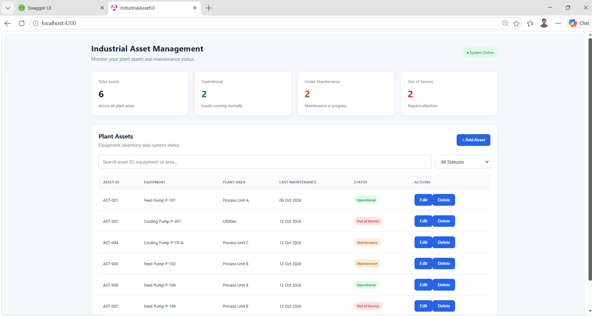
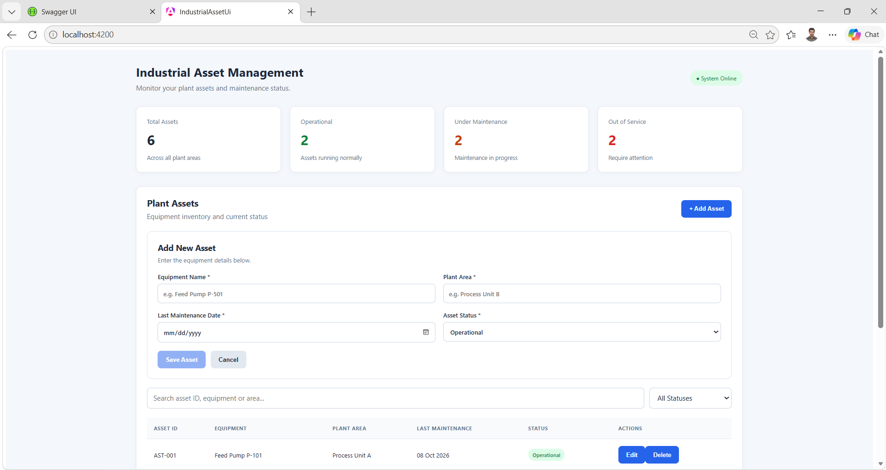
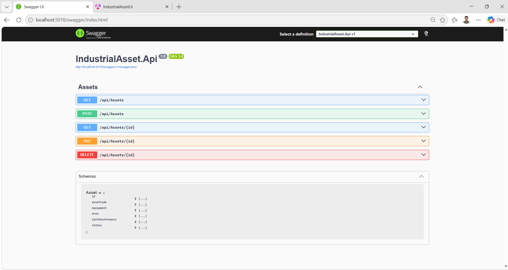

# Industrial Asset Management System

A full-stack industrial asset management application for tracking plant equipment, maintenance dates, operating status, and asset records.

## Technology Stack

- **Backend:** C#, ASP.NET Core Web API, Entity Framework Core
- **Frontend:** Angular, TypeScript, HTML, SCSS
- **Database:** Microsoft SQL Server
- **Testing:** xUnit, EF Core InMemory
- **API Documentation:** Swagger / OpenAPI
- **Version Control:** Git and GitHub

## Features

- Create, view, update, and delete industrial assets
- Track asset codes, equipment names, plant areas, maintenance dates, and operating status
- Search and filter assets in the dashboard
- Validate required fields and prevent duplicate asset codes
- Store asset records in SQL Server
- Test controller behavior using xUnit and an isolated in-memory database

## Project Structure

```text
industrial-asset-management/
├── IndustrialAsset.Api/
│   ├── Controllers/
│   ├── Data/
│   ├── Migrations/
│   ├── Models/
│   └── Program.cs
├── IndustrialAsset.Api.Tests/
│   └── UnitTest1.cs
├── industrial-asset-ui/
│   └── src/
└── .gitignore
```

## Prerequisites

- .NET 10 SDK
- Node.js and npm
- Angular CLI compatible with the project
- Microsoft SQL Server
- Visual Studio Code or another suitable IDE

## Run the Backend

1. Configure the SQL Server connection string in your local configuration.
2. Open a terminal in the repository root.
3. Run:

```bash
cd IndustrialAsset.Api
dotnet restore
dotnet ef database update
dotnet run
```

Use the API URL and Swagger address shown by the application.

## Run the Frontend

Open another terminal:

```bash
cd industrial-asset-ui
npm install
ng serve
```

Open `http://localhost:4200` in your browser.

Ensure the backend is running and the frontend API URL matches the backend address.

## Run Automated Tests

From the repository root:

```bash
dotnet test IndustrialAsset.Api.Tests/IndustrialAsset.Api.Tests.csproj
```

The current development milestone includes 10 passing automated tests covering asset model behavior, CRUD operations, and invalid requests.

## Application Screenshots

### 1. Asset Management Dashboard



### 2. Add or Edit Asset



### 3. Swagger API Documentation



## API Endpoints

| Method | Endpoint | Purpose |
|---|---|---|
| GET | `/api/Assets` | Retrieve all assets |
| GET | `/api/Assets/{id}` | Retrieve an asset by ID |
| POST | `/api/Assets` | Create an asset |
| PUT | `/api/Assets/{id}` | Update an asset |
| DELETE | `/api/Assets/{id}` | Delete an asset |

## Future Enhancements

- Employee management and asset assignment
- Authentication and role-based authorization
- Maintenance history and work orders
- Pagination and advanced filtering
- Automated CI builds and test execution
- Cloud deployment

## Author

Developed as a portfolio project to demonstrate full-stack .NET development, REST API design, SQL Server integration, Angular development, and automated testing.
